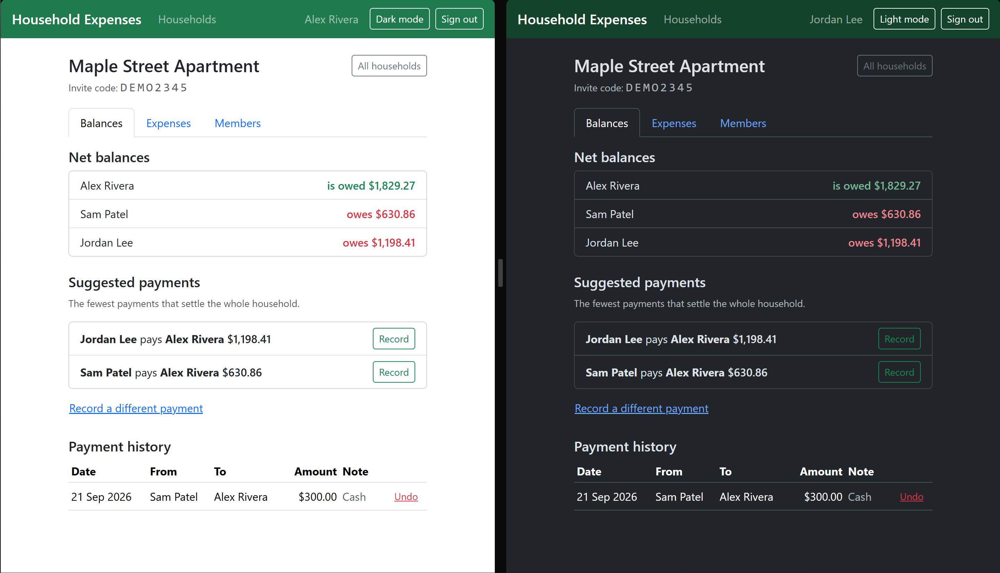
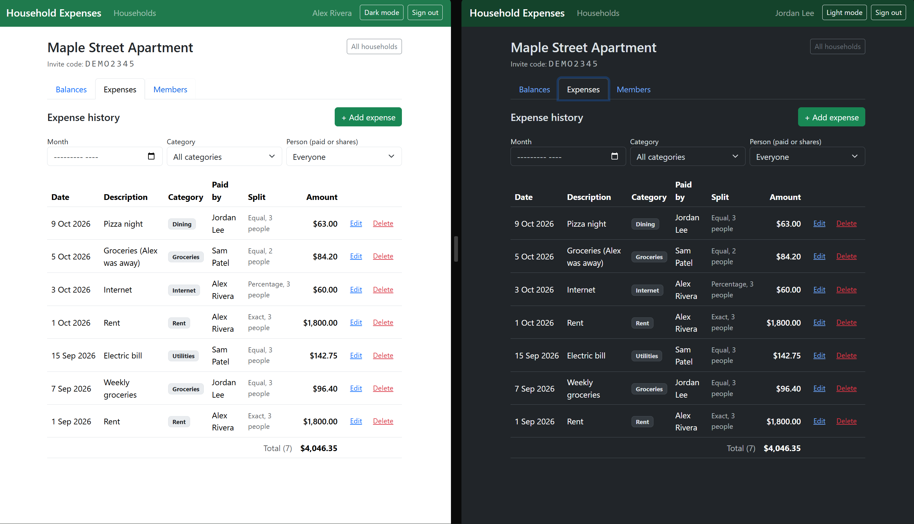
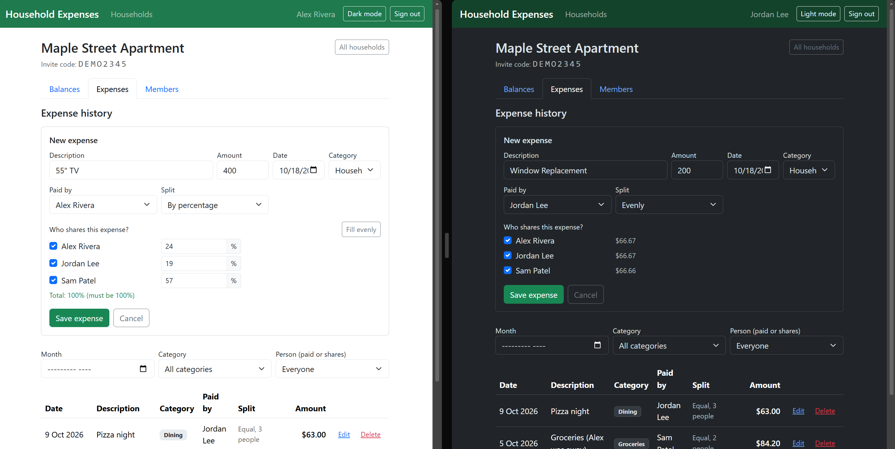
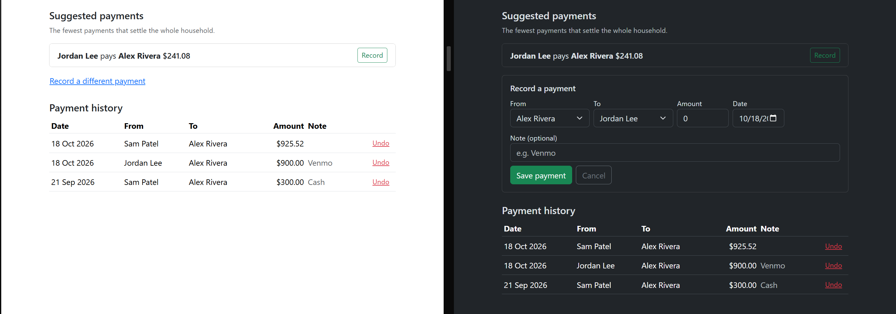

# Household Expense Tracker

Create a household, invite roommates or family, log shared expenses, and see who owes whom. Debts are simplified so the group settles up with as few payments as possible.

## Features

- Sign up / log in (ASP.NET Core Identity + JWT), create a household or join one with an invite code
- Add expenses with a payer, amount, category, and split **evenly**, **by percentage**, or by **exact amounts** (splits always add up to the cent)
- Balance dashboard: each person's net balance + suggested payments
- Record settlements when someone pays someone back
- Expense history filtered by month, category, or person
- Users only ever see households they belong to (others return 404)
- Light and dark themes: a toggle in the nav bar, remembered between visits and defaulting to your system setting

## Screenshots

Each screenshot shows the light theme on the left (signed in as Alex) and the dark theme on the right (signed in as Jordan), both looking at the same household.

**Balances and suggested payments.** Net balance per person, and the fewest payments that settle the household.



**Expense history.** Every expense with its category, payer and split type. Filter by month, category or person.



**Adding an expense.** Split evenly, by percentage, or by exact amounts. On the left is a percentage split with its running total (green when it adds up to 100, red when it doesn't); on the right is an even split showing each person's share, with the odd cent handled so the shares always add up.



**Recording a payment.** Click "Record" on a suggested payment, or enter any payment by hand. Recorded payments show in the history and update everyone's balance.



## Solution layout

| Project | Purpose |
|---|---|
| `src/HouseholdExpenses.Core` | Pure C#, **no DB/web dependencies**: `DebtSimplifier`, `BalanceCalculator`, `SplitCalculator`, shared DTOs/enums |
| `src/HouseholdExpenses.Api` | ASP.NET Core Web API: EF Core + SQLite, Identity + JWT, controllers, Swagger, global error handling |
| `src/HouseholdExpenses.Web` | Blazor WebAssembly front end (talks to the API over HTTP with the JWT) |
| `tests/HouseholdExpenses.Tests` | xUnit: unit tests for the Core logic + integration tests that boot the real API against a temp SQLite file |

## Running it

Requires the **.NET 8 SDK** (the latest 8.0.x patch; see [Troubleshooting](#troubleshooting) if `dotnet` complains). Check what you have with `dotnet --list-sdks` and `dotnet --list-runtimes`.

Run these from the repository root. On Windows, wrap any path that contains a space in quotes.

```bash
# terminal 1 - API on http://localhost:5080 (Swagger UI at /swagger)
dotnet run --project src/HouseholdExpenses.Api --launch-profile http

# terminal 2 - Blazor UI on http://localhost:5173
dotnet run --project src/HouseholdExpenses.Web --launch-profile http
```

Open http://localhost:5173 and sign in with one of the demo accounts below, or sign up with your own.

The SQLite database (`household.db`) is created and migrated automatically on API startup.

### Demo accounts

When the API runs in the Development environment it seeds three fake users and a household called "Maple Street Apartment" with two months of expenses (rent, groceries, utilities, internet, dining) using all three split types, plus one settlement. The addresses use `example.com`, which is reserved for documentation, so none of them belong to a real person.

| Name | Email | Password |
|---|---|---|
| Alex Rivera (household owner) | `alex.rivera@example.com` | `Demo1234!` |
| Jordan Lee | `jordan.lee@example.com` | `Demo1234!` |
| Sam Patel | `sam.patel@example.com` | `Demo1234!` |

Sign in as one person in a normal window and another in a private window to see the same household from two sides. To join the household with a brand new account, use the invite code `DEMO2345`.

Seeding is controlled by `Seed:DemoData` in `appsettings.Development.json` and is off everywhere else. It only runs once; delete `household.db` to reset the demo data.

```bash
dotnet test        # runs everything
```

## Troubleshooting

**"You must install or update .NET to run this application"** (it lists the frameworks it found and says it wanted something like `Microsoft.NETCore.App 8.0.32`)
The app was built by an SDK that is newer than the .NET runtime installed system-wide. Install the current .NET 8 SDK, which includes a matching runtime, then open a new terminal:

```powershell
winget install Microsoft.DotNet.SDK.8
```

Or download it from https://dotnet.microsoft.com/download/dotnet/8.0. Having .NET 10 installed does not help; the project targets .NET 8 and needs an 8.0.x runtime.

**"No .NET SDKs were found"**, or `dotnet` is not recognized
Only the runtime is installed, or it is not on your PATH. Install the SDK as above and restart the terminal. If you installed the SDK to a custom folder, point to it for the current session:

```powershell
$env:DOTNET_ROOT = "C:\path\to\dotnet"; $env:PATH = "$env:DOTNET_ROOT;$env:PATH"
```

**`cd` fails with "A positional parameter cannot be found"** (PowerShell)
The folder path has a space in it. Quote it: `cd "C:/Users/me/Documents/Coding Projects/HouseholdExpenseTracker"`.

**Build error `MSB3027` / "file is locked by: HouseholdExpenses.Api"**
The API is still running from an earlier `dotnet run`, so the build cannot overwrite its DLLs. Stop it with Ctrl+C in that terminal (or end the process in Task Manager), then build again.

**The page loads but shows "Can't reach the server"**
The API is not running, or the front end is pointed at the wrong address.
- Start the API (terminal 1 above) and check http://localhost:5080/swagger opens.
- `ApiBaseUrl` in `src/HouseholdExpenses.Web/wwwroot/appsettings.json` must match the API address.
- If you serve the front end on a different port, add that origin to `Cors:AllowedOrigins` in the API's `appsettings.Development.json`. The browser blocks the calls otherwise.

**The API exits with "Jwt:Key must be set"**
Outside the Development environment there is no signing key. Set one (32+ characters): `dotnet user-secrets set "Jwt:Key" "<random string>" --project src/HouseholdExpenses.Api`, or the `Jwt__Key` environment variable.

**"Address already in use"** on port 5080 or 5173
Another copy of the app is running. Stop it, or pass a different `--urls http://localhost:PORT` (and update `ApiBaseUrl` / `Cors:AllowedOrigins` to match).

**Start over with a clean database**
Stop the API and delete `household.db` in `src/HouseholdExpenses.Api`. It is recreated on the next start.

**`dotnet ef` is not found**
Run `dotnet tool restore` once from the repository root; it installs the version pinned in `.config/dotnet-tools.json`.

**Dark mode looks wrong after an update**
Hard-refresh the page (Ctrl+F5). The old stylesheet may be cached by the browser.

## Configuration

| Setting | Where | Notes |
|---|---|---|
| `Seed:DemoData` | `appsettings.Development.json` | `true` creates the demo accounts above on startup; leave it unset in production |
| `Jwt:Key` | `appsettings.Development.json` (dev only) | **Must be overridden in production** (>= 32 chars). Use `dotnet user-secrets` or the `Jwt__Key` env var |
| `ConnectionStrings:Default` | `appsettings.json` | defaults to `Data Source=household.db` |
| `Cors:AllowedOrigins` | `appsettings*.json` | the origin(s) the Blazor app is served from |
| `ApiBaseUrl` | `src/HouseholdExpenses.Web/wwwroot/appsettings.json` | where the front end finds the API |

## How the debt simplification works

1. **Net balance** for each member = (everything they paid) - (their share of every expense) + (settlements they paid) - (settlements they received). Positive = owed money; negative = owes money. Balances always sum to zero.
2. **Greedy matching** (`DebtSimplifier`): repeatedly pair the largest debtor with the largest creditor and transfer `min(debt, credit)`. Each payment fully clears at least one person, so n people need at most n-1 payments. Example: A owes B $10 and B owes C $10 -> B nets to zero -> suggestion is **A pays C $10**.

Greedy gives a very good result but isn't guaranteed to be the true minimum for every possible group (that is the NP-hard subset-sum-partition problem). For household-sized groups it's the standard, practical choice.

Money is handled as `decimal`, and uneven splits use largest-remainder allocation: $10.00 / 3 -> $3.34 + $3.33 + $3.33.

## Switching from SQLite to PostgreSQL / SQL Server

1. Swap the package: `Microsoft.EntityFrameworkCore.Sqlite` -> `Npgsql.EntityFrameworkCore.PostgreSQL` or `Microsoft.EntityFrameworkCore.SqlServer`.
2. In `Program.cs` replace `UseSqlite(...)` with `UseNpgsql(...)` / `UseSqlServer(...)` and update the connection string.
3. Migrations are provider-specific: delete `src/HouseholdExpenses.Api/Data/Migrations` and run
   `dotnet ef migrations add InitialCreate --project src/HouseholdExpenses.Api --output-dir Data/Migrations`
   (`dotnet tool restore` installs the pinned `dotnet-ef`).
4. Note: SQLite can't sum/order `decimal` in SQL, so balances are computed in memory. That's fine here and keeps working on other providers.

## API overview (see Swagger for full detail)

```
POST   /api/auth/register | /api/auth/login
GET    /api/households                         POST /api/households
POST   /api/households/join                    GET/PUT/DELETE /api/households/{id}
DELETE /api/households/{id}/members/me         (leave; balance must be settled)
GET    /api/households/{id}/expenses?month=yyyy-MM&category=Rent&userId=...
POST   /api/households/{id}/expenses           GET/PUT/DELETE .../expenses/{expenseId}
GET    /api/households/{id}/balances           (net balances + suggested payments)
GET    /api/households/{id}/settlements        POST .../settlements   DELETE .../settlements/{id}
```

## Design notes / known limits

- Any household member can edit or delete any expense or settlement (household-level trust). Only the owner can rename/delete the household.
- A member can't leave while their balance is non-zero, so the ledger never references someone who is gone with unsettled debt.
- Single currency; the symbol is set in `Fmt.CurrencySymbol` in the Web project.
- JWTs are kept in `localStorage` (simple for a SPA, but exposed to XSS); there are no refresh tokens, so sessions last `Jwt:ExpiryMinutes` (8h default).

## Ideas for next steps

Receipts/attachments, recurring expenses (rent), multi-currency, email invites, activity feed, refresh tokens, pagination on the history endpoint.
